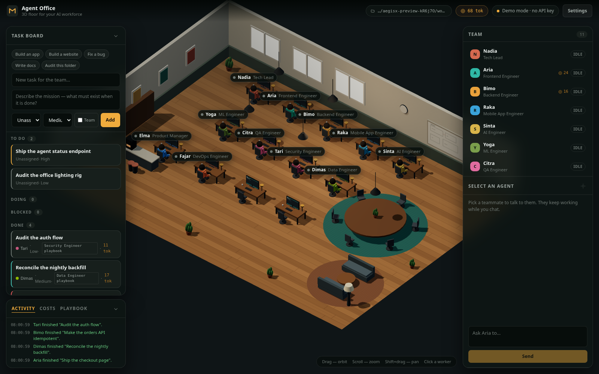
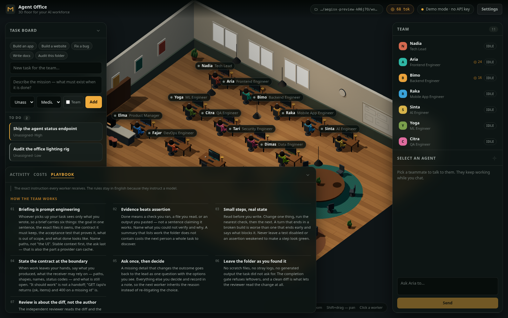

# AegisX-Worker

[English](README.md) · **Bahasa Indonesia**

**Kantor virtual 3D tempat pekerja AI tampil sebagai karakter.** Setiap agen
adalah panggilan model sungguhan ke endpoint yang kompatibel OpenAI dan Anda
kendalikan — Anda membawa kuncinya, kantor yang menjalankan pertunjukannya.



*Sebelas pekerja di satu lantai isometrik. Papan di kanan adalah sumber
kebenaran: kartu berstatus `todo`, `doing`, `blocked`, atau `done`, dan pekerja
yang Anda lihat adalah yang ditagih untuk task itu.*

**Misi tim** mengubah satu kalimat menjadi pekerjaan mereka: lead memecah brief,
menyerahkan tiap bagian ke spesialis yang cocok, bagian-bagian berjalan paralel,
lalu lead dijalankan ulang setelah semuanya selesai untuk merekonsiliasi hasil
sebelum misi ditandai selesai. Tidak ada yang dianggap selesai karena pekerjanya
mengatakan begitu — sebuah check, reviewer independen, dan merge gate berdiri di
depan papan.

- **Anda membawa modelnya.** Endpoint apa pun yang kompatibel OpenAI; kunci
  hidup di memori server selama sesi dan tidak pernah mencapai browser atau disk.
- **Folder tetap milik Anda.** Setiap tool file, shell, dan preview terkurung di
  folder yang Anda pilih, dengan path guard, allowlist perintah, dan sandbox
  `bwrap`.
- **Bisa diaudit.** Prompt-nya bisa dibaca (`GET /api/playbook`), setiap
  keputusan menjadi baris log, dan check yang menjaga para pekerja adalah bagian
  dari suite yang bisa Anda jalankan sendiri.

## Daftar isi

| Bagian | Isinya |
| --- | --- |
| [Apa yang dilakukannya](#apa-yang-dilakukannya) | Kemampuan, satu baris masing-masing, beserta check di belakangnya |
| [Playbook di layar](#playbook-di-layar) | Apa yang diberitahukan ke tiap pekerja, dan apa yang ditolak reviewer |
| [Instalasi](#instalasi) · [Kebutuhan](#kebutuhan) · [Menjalankan](#menjalankan) | Satu perintah, atau clone manual; lalu pekerja menulis di folder Anda |
| [Konfigurasi](#konfigurasi) | Setiap variabel environment dan efeknya |
| [Arsitektur](#arsitektur) | Peta file, completion gate, isolasi, dua bahasa |
| [Verifikasi](#verifikasi) | Check-nya, biayanya, dan apa yang tidak bisa dibuktikan |
| [Catatan keamanan](#catatan-keamanan) | Batas kepercayaan, dinyatakan terus terang |
| [Roadmap](#roadmap) | Selesai, sedang berjalan, dan yang sengaja belum ada |
| [Lisensi](#lisensi) | MIT — pakai, fork, publikasikan |

## Apa yang dilakukannya

- **Kantor 3D langsung** — lantai isometrik low-poly dengan meja, monitor,
  tanaman, meja rapat, sudut kopi, dan papan tulis. Sebelas pekerja seed muncul
  di meja mereka, duduk menghadap monitor, mengetik, dan bereaksi.
- **Status di avatar** — `idle`, `working`, `blocked`, `error`, `meeting`
  tampil di scene (postur + warna) dan di roster.
- **Chat dari dalam kantor** — pilih pekerja, ajak bicara, lihat jawabannya
  mengalir. Mereka tetap mengerjakan task sambil mengobrol dengan Anda.
- **Papan task** — buat, tugaskan, dan prioritaskan pekerjaan. Pekerja yang
  ditugaskan mengambilnya otomatis dan bisa mendelegasikan ke rekan lain.
- **Satu prompt, satu tim** — centang **Team** (atau pakai `--team`) dan lead
  merencanakan, mendelegasikan ke beberapa spesialis sekaligus, lalu
  merekonsiliasi hasilnya. Subtask dibatasi dan dideduplikasi, lead yang berhenti
  menunggu tidak ditandai blocked, dan misi yang tidak pernah konvergen diblokir
  dengan alasan yang jelas alih-alih menggantung selamanya.
- **Misi cepat** — lima chip di atas papan (*Build an app*, *Build a website*,
  *Fix a bug*, *Write docs*, *Audit the code*) mengisi brief nyata dan memilih
  pekerja yang cocok, jadi tidak ada yang perlu menulis prompt dari nol.
- **Playbook, bukan tebakan** — setiap pekerja berjalan di bawah *pack* peran
  bernama: standar craft untuk peran itu, bukti yang menutup task, dan kegagalan
  yang harus ditolak reviewer independen. Di atasnya ada satu **doktrin tim**
  bersama — briefing sebagai prompt engineering, bukti di atas klaim, langkah
  kecil, kontrak saat serah terima. Keduanya adalah teks yang benar-benar
  diterima model, bisa dibaca di tab **Playbook** dan di `GET /api/playbook`,
  bukan parafrase. Pack dipilih oleh lead (`role_pack`), oleh jabatan pekerja,
  atau — untuk peran generik — dari isi brief, sehingga migrasi yang diserahkan
  ke seorang engineer tetap dinilai sebagai pekerjaan data.
- **Brief dinilai sebelum task ada** — `create_task` menolak delegasi yang tidak
  menyebut file, perintah, endpoint, atau ruang lingkup read-only yang eksplisit,
  dan menyebutkan persis apa yang harus ditambahkan. Brief tipis tapi berguna
  diterima dengan satu baris saran (tanpa acceptance test / tanpa batas). Lead
  melihat penolakan di hasil tool dan memperbaiki serah terimanya, bukan membiarkan
  pekerja menebak.
- **Pekerja harus membuktikannya** — `complete_task` tidak dipercaya begitu saja.
  Server menjalankan check milik folder itu lebih dulu (`tsc --noEmit`,
  `npm test`, `npm run build`, `go vet`, `pytest`, dan link check untuk setiap
  `index.html`). Kalau check gagal, task dibuka lagi dengan teks error dan
  pekerja melanjutkan. Task baru ditandai done ketika check lulus atau percobaan
  perbaikan habis — dan kegagalan yang belum diperbaiki dicatat di task, tidak
  pernah disembunyikan.
- **Folder mengingat** — task yang selesai meninggalkan fakta tahan lama (baris
  `remember` pilihan pekerja plus check yang benar-benar dimiliki folder). Misi
  berikutnya dimulai dengan fakta itu di prompt-nya alih-alih menemukan ulang hal
  yang sama, dan filenya Markdown biasa yang bisa Anda edit. Lihat *Folder
  mengingat* di bawah.
- **Checkpoint + diff** — sebelum aksi pertama, folder mendapat baseline git
  (hanya bila belum berupa repo, jadi riwayat Anda tidak pernah disentuh), dan
  catatan penutup mencantumkan persis apa yang berubah.
- **Baca berjendela, edit toleran** — `read_file` membagi file panjang dengan
  `offset`/`limit` alih-alih membanjiri konteks, dan `edit_file` tetap berhasil
  saat hanya indentasi atau spasi di ujung baris yang bergeser.
- **Melihat halaman yang dibuatnya** — `preview_screenshot` merender HTML di
  Chrome headless pada lebar apa pun dan menyimpan PNG, sehingga misi web bisa
  dinilai dari layout sungguhan, bukan tebakan.
- **Follow camera** — kunci kamera ke satu pekerja dan tonton mejanya.
- **Linimasa aktivitas** — setiap panggilan model, aksi, tulis file, dan perintah
  dicatat di UI dan dialirkan ke browser lewat SSE.
- **Toolkit agen lengkap** — baca/tulis/edit/append/hapus file, daftar folder,
  cari isi file, terapkan patch unified, temukan definisi simbol dan pemanggilnya,
  jalankan check milik folder, jalankan perintah shell yang di-allowlist, kirim
  permintaan HTTP, cari web, dan ambil halaman. Tool dipanggil lewat function
  calling native OpenAI, dengan protokol JSON-action lama sebagai fallback untuk
  endpoint yang menolak `tools`.
- **Satu gerbang di depan setiap tool** — `server/src/policy.ts` memutuskan
  allow / review / deny sebelum tool berjalan (path containment, file rahasia,
  provenance setelah baca web, budget token, batas proses, publishing), dan setiap
  observasi melewati `server/src/redact.ts` supaya kunci tidak bisa menjadi
  konteks model.
- **Task yang saling menunggu** — `create_task` menerima `depends_on`; scheduler
  mengantrekan task dan membangunkannya saat dependensi terakhir selesai, jadi
  lead cukup menyatakan urutannya sekali alih-alih menserialkan tim dengan tangan.
- **Router fase** — pekerja dikirimi tool untuk fase yang sedang dijalaninya
  (inspect → edit → verify → wrap), bukan semua 29 setiap round: 56% lebih
  sedikit token skema pada misi 12 round yang diukur.
- **Reviewer independen** — setelah check lulus, panggilan model kedua membaca
  diff dan bisa menolak perubahan, mengirim pekerja kembali dengan alasannya. Di
  repository, diff diambil dari checkout task itu sendiri, jadi review juga
  berjalan di sana alih-alih menyetujui semua yang kebetulan Anda versikan.
- **Gambar yang bisa dilihat model** — `read_media` melampirkan PNG/JPEG/WebP
  sebagai content part, jadi screenshot atau referensi desain adalah bukti,
  bukan sekadar path.
- **Kritikus visual** — setelah check dan review kode, satu lintasan independen
  melihat screenshot yang ditinggalkan task dan bisa menolak halaman yang
  berfungsi tetapi tampak rusak.
- **Tulisan yang tidak bisa bertabrakan diam-diam** — kunci per-file dipegang
  selama panggilan yang memutasi, sehingga dua pekerja yang mengedit `app.ts`
  mendapat satu tulisan dan satu `path_locked` yang bisa dicoba ulang, bukan
  kejutan last-writer-wins. Tulisan berdasarkan bacaan basi ditolak dengan
  `stale_read` sampai file dibaca lagi, dan perintah shell memakai kunci
  folder-wide sehingga tidak bisa berjalan di atas file yang sedang ditulis ulang
  pekerja lain.
- **Merge gate** — file yang sudah diverifikasi sebuah task di-hash, dan
  penyelesaian memeriksanya ulang setelah reviewer dan kritikus melihat; kalau
  pekerja lain mengubahnya di sela-sela, task dikirim balik alih-alih mengklaim
  pohon hijau yang sudah tidak ada.
- **Checkout per task** — bila folder adalah repository git milik operator,
  setiap task bekerja di worktree sendiri yang dibangun dari `HEAD` plus file yang
  belum di-commit, sehingga dua pekerja yang mengedit satu file tidak bisa saling
  menghapus. Pekerjaan mendarat lewat antrean merge hanya setelah check lulus:
  file yang diubah orang lain di sela-sela ditolak dengan namanya, salinan pekerja
  disegarkan ke teks terkini, dan versi sebelumnya disimpan sebagai rujukan. File
  milik office (screenshot, state shadow repo) tidak pernah mendarat: itu milik
  kantor, bukan task. Folder yang bukan repository — atau yang dibuat office
  untuk checkpoint-nya sendiri — berjalan shared, dengan satu baris log yang
  menjelaskan alasannya. Checkout task yang blocked dipertahankan, lalu diambil
  kembali berdasarkan umur dan batas jumlah pada run berikutnya, tidak pernah
  milik task yang sedang berjalan.
- **Observasi terjaga** — setiap hasil tool divalidasi sebelum menjadi konteks
  model: ringkasan kosong, entri `next_actions` tak dikenal, atau kode error asing
  diperbaiki atau dicatat, tidak pernah diteruskan begitu saja.
- **Kontrak hasil per-tool** — bentuk saja tidak cukup, jadi setiap tool
  mendeklarasikan apa yang **wajib** dibawa sebuah sukses ke model: `read_file`
  harus membawa teks file, `read_media` harus melampirkan gambar, sebuah tulis
  harus menyebut artefaknya, dan `complete_task` harus menutup turn. Panggilan
  yang melapor sukses tanpa payload-nya ditolak dan ditampilkan ke model sebagai
  kegagalan, bukan bukti. `check:outputs` membuktikan kedua sisi dan menjalankan
  panggilan tool nyata — baca, tulis, daftar, patch, perintah, fetch gagal —
  terhadap kontraknya sendiri.
- **Argumen dicek terhadap schema tool itu sendiri** — enum yang salah ketik
  ditolak dengan menyebut nilai yang diterima, bukan dipaksa menjadi default lalu
  dilaporkan sukses.
- **Pilih folder kerja apa pun** — header menunjukkan folder tempat agen bekerja;
  **Settings → Browse…** menelusuri filesystem dan memindahkan run ke folder yang
  Anda pilih. Pilihannya bertahan setelah restart.
- **Bawa kunci sendiri** — tempel API key di Settings; kunci disimpan di memori
  server untuk sesi dan tidak pernah ditulis ke disk atau dikirim ke browser.
- **Model gratis secara default** — `deepseek/deepseek-v4-1-flash` (free tier)
  adalah model default, dan office otomatis fallback ke sana ketika model pilihan
  Anda kehabisan kredit atau tidak diekspos oleh endpoint.

## Playbook di layar



*Tab Playbook bukan dokumentasi tentang prompt — itu teks yang diterima setiap
pekerja, dibaca dari sumber yang sama yang dikirim server ke model.*

Setiap peran berjalan di bawah sebuah **pack**: standar craft untuk peran itu,
bukti yang menutup task, dan kegagalan yang harus ditolak reviewer independen. Di
atas semuanya ada satu **doktrin tim** bersama — briefing ke rekan sebagai prompt
engineering, bukti di atas klaim, langkah kecil, kontrak saat serah terima —
sehingga prefiks yang dibayar setiap pekerja identik dan bisa di-cache.

Pack dipilih dalam tiga langkah, dan pilihannya terlihat, bukan terkubur di
dalam prompt:

1. lead menyebutkannya (`role_pack` di `create_task`) — satu-satunya override
   eksplisit;
2. kalau tidak, jabatan pekerja yang menentukan;
3. untuk peran generik, brief yang menentukan — **berbobot**, bukan cocok
   pertama: file yang disebut task (`.sql`, `.tsx`, `Dockerfile`) bernilai tiga
   poin, satu kata tentang pekerjaan satu poin, dan kata berbeda kedua satu poin
   lagi. Artefak mengalahkan kombinasi kata apa pun; dua kata mengalahkan satu;
   seri disebutkan, bukan disembunyikan.

Kartu menampilkan playbook-nya (`Frontend Engineer playbook`) dan siapa yang
memilihnya, log aktivitas mencatat buktinya (`the brief points there
(site/index.html)`), dan reviewer diberi field yang sama — sehingga standar yang
dipakai menilai pekerjaan tidak bisa melenceng dari yang diklaim kartu. Ketika
reviewer menolak, penolakan disimpan sebagai data: tab Playbook meranking
penolakan per pack dan menyebut aturan yang paling sering dikutip, yang membuat
baris aturan yang kabur ditemukan dan ditulis ulang dari bukti, bukan selera.

## Kebutuhan

- Node.js >= 22.6 (memakai eksekusi TypeScript native)
- Chrome/Chromium untuk scene 3D (WebGL)

## Instalasi

Satu perintah, tanpa `sudo`, tanpa instal npm global:

```bash
curl -fsSL https://raw.githubusercontent.com/aegisxresearch/AegisX-Worker/main/install.sh | bash
```

Itu menyalurkan skrip remote ke shell, jadi baca dulu bila Anda mau — filenya
[`install.sh`](install.sh) di repo ini:

```bash
curl -fsSLO https://raw.githubusercontent.com/aegisxresearch/AegisX-Worker/main/install.sh
less install.sh
bash install.sh
```

Yang dilakukan installer:

1. memeriksa Node.js >= 22.6, npm, dan tar (plus git, atau curl sebagai
   fallback);
2. mengambil source ke `~/.aegisx-worker` — `git clone` pada ref pilihan, atau
   tarball GitHub bila git tidak ada;
3. memasang dependensi workspace (`npm ci`, fallback ke `npm install` hanya bila
   lockfile tidak bisa dipenuhi);
4. membangun bundle browser;
5. menautkan `aegisxworker` dengan `npm link`, atau menulis
   `~/.local/bin/aegisxworker` bila prefix npm global tidak bisa ditulis — tidak
   pernah meminta root;
6. menjalankan `aegisxworker --version`, sehingga instalasi rusak gagal di sini,
   bukan pada misi pertama Anda.

| Opsi | Default | Arti |
| --- | --- | --- |
| `--dir <path>` | `$AEGISX_HOME` atau `~/.aegisx-worker` | Tempat source disimpan |
| `--ref <branch\|tag>` | `main` | Kunci instalasi ke branch atau tag |
| `--tarball` | mati | Lewati git sepenuhnya dan unduh arsip |
| `--no-build` | mati | Lewati build client (CLI membangunnya saat run pertama) |
| `--no-link` | mati | Jangan pasang perintah `aegisxworker` |
| `--dry-run` | mati | Cetak rencana, tidak mengubah apa pun |

Menjalankan ulang installer akan memperbarui instalasi yang ada di tempat. Folder
yang bukan buatannya tidak pernah disentuh: direktori tidak kosong tanpa penanda
`.aegisx-install` ditolak dengan pesan, bukan ditimpa.

```bash
AEGISX_HOME=~/src/aegisx bash install.sh   # folder kustom
bash install.sh --ref v0.1.0              # pin yang bisa direproduksi
bash install.sh --dry-run                 # lihat rencananya dulu
```

Untuk menghapus: `npm unlink -g agent-office` (bila tertaut) lalu hapus folder
instalasi. Tidak ada yang ditulis di luar folder itu dan
`~/.local/bin/aegisxworker`.

| Gejala | Sebab dan solusi |
| --- | --- |
| `Node.js v… is too old` | Butuh Node >= 22.6 (eksekusi TypeScript native); `nvm install 22` atau upgrade |
| `npm link failed … writing a wrapper` | Prefix npm global tidak bisa ditulis; wrapper *adalah* instalasinya — tambahkan `~/.local/bin` ke `PATH` |
| `fatal: Remote branch … not found` | `--ref` menyebut branch/tag yang tidak ada; pakai `main` atau tag nyata |
| `curl: (22) … 404` | Sama, pada jalur tarball: periksa ref-nya |
| `preview_screenshot` tidak menemukan Chrome | Pasang Chrome/Chromium, atau set `CHROME_PATH` |
| Perintah berjalan tanpa sandbox | `bwrap` tidak ada; pasang `bubblewrap`, atau terima `OFFICE_JAIL=0` dengan sadar |

## Menjalankan

Manual, dari hasil clone — jalur ini yang dipakai bila Anda ingin membaca dan
mengubah kodenya:

```bash
npm install
cp .env.example .env      # tempel kunci Anda di sini
npm link                  # membuat perintah `aegisxworker` tersedia
```

### Dari folder mana pun — `aegisxworker`

Perintah yang akan Anda pakai sehari-hari. `cd` ke proyek yang ingin dikerjakan
lalu ketik `aegisxworker`: folder itu menjadi workspace, kantor menyala, browser
terbuka, dan setiap tool file/shell/preview berjalan di dalamnya.

```bash
cd ~/projects/my-site
aegisxworker                       # buka kantor di folder ini
```

Beri misi dan ia bekerja sambil Anda menonton:

```bash
aegisxworker "build a landing page for a specialty coffee shop"
```

CLI mencetak log setiap aksi dengan timestamp (`write_file`, `read_file`,
`web_search`, …), catatan pekerja, dan hasil akhir, lalu mematikan servernya.
Tambahkan `--keep` untuk membiarkan kantor tetap terbuka.

```bash
aegisxworker --team "build a booking app with an AI assistant"
aegisxworker -C ~/projects/api "add a /health endpoint and a test"
aegisxworker --agent Bimo "fix the broken mobile nav"
aegisxworker --demo "try the office without burning credit"
aegisxworker --no-open          # mulai tanpa membuka browser
```

`--team` merutekan brief lewat lead dan seluruh roster; `--solo` memaksa satu
pekerja. Tanpa keduanya CLI memutuskan: brief yang mencakup dua disiplin (misalnya
UI **dan** API, atau aplikasi **dengan** asisten AI) masuk ke tim, sisanya ke satu
spesialis.

Opsi: `-C/--dir`, `-p/--port` (naik otomatis bila bentrok), `--team`, `--solo`,
`--agent`, `-k/--key`, `--endpoint`, `-m/--model`, `--demo`, `--no-tools`,
`--no-web`, `--no-open`, `--keep`, `-t/--timeout` (menit, default 20 — atau 30
untuk misi tim), `-v/--verbose`, `-h`.

### Resep: website dari folder kosong

```bash
mkdir my-landing && cd my-landing
aegisxworker "build a landing page for a specialty coffee shop named Kopi Senja"
```

1. CLI membangun UI bila source berubah, memilih port, dan menyalakan server
   dengan `OFFICE_WORKSPACE` menunjuk folder tempat Anda berdiri.
2. Ia terhubung ke endpoint di `.env`, membuat task di papan, dan menugaskannya ke
   pekerja yang perannya cocok (misi web ke frontend engineer; `--agent`
   menimpa pilihan itu).
3. Pekerja mendaftar isi folder, menulis `index.html`, `styles.css`, dan
   `script.js`, membacanya kembali, lalu baru memanggil `complete_task`.
4. Anda mendapat situs statis yang bisa dijalankan — tanpa build step, tanpa
   `npm install`. Buka `index.html` atau sajikan dengan
   `python3 -m http.server`.

Brief misinya sendiri membawa kontrak pengiriman (HTML semantik, copy nyata,
favicon SVG inline, layout responsif, tanpa placeholder), sehingga hasilnya
halaman jadi, bukan kerangka.

### Dev server dan build produksi

```bash
npm run dev               # API di :8787, client di :5173
```

Buka <http://127.0.0.1:5173>, klik **Settings**, tempel API key, tekan
**Connect**. Tanpa kunci kantor tetap berjalan dalam mode demo dengan pekerja
tertulis, jadi Anda bisa langsung mencoba scene 3D-nya.

Build ala produksi (satu proses menyajikan API dan client hasil build):

```bash
npm run build
npm start                  # http://127.0.0.1:8787
```

## Konfigurasi

| Variabel | Default | Arti |
| --- | --- | --- |
| `OFFICE_ENDPOINT` | `https://ai.sinarcloud.com/v1` | Base URL apa pun yang kompatibel OpenAI |
| `OFFICE_API_KEY` | — | Kunci endpoint (hanya di memori) |
| `OFFICE_MODEL` | `deepseek/deepseek-v4-1-flash` | Model id untuk pekerja (free tier secara default) |
| `OFFICE_TOOLS` | `0` | `1` mengaktifkan tool file/shell ber-sandbox saat boot |
| `OFFICE_PORT` | `8787` | Port API |
| `OFFICE_CLIENT_ORIGIN` | `http://127.0.0.1:5173` | Origin browser yang diizinkan saat dev |
| `OFFICE_WORKSPACE` | `workspace` | Folder kerja default (bisa diubah di UI) |
| `OFFICE_STATE_DIR` | `.agent-office` | Tempat papan misi disimpan antar-restart |
| `OFFICE_MAX_ROUNDS` | `40` | Round trip model/tool per turn |
| `OFFICE_TOKEN_BUDGET` | `400000` | Batas token per turn; loop berhenti dengan rapi |
| `OFFICE_VERIFY` | `1` | `0` mematikan completion gate |
| `OFFICE_VERIFY_ATTEMPTS` | `2` | Percobaan perbaikan sebelum check gagal dicatat |
| `OFFICE_LOCALE` | `en` | Bahasa yang dipakai tim sampai browser menimpa |
| `OFFICE_GIT` | `1` | `0` mematikan checkpoint otomatis |
| `OFFICE_JAIL` | `1` | `0` menjalankan tool shell tanpa sandbox bwrap |
| `OFFICE_JAIL_NET` | `0` | `1` memberi `run_command` akses jaringan |
| `CHROME_PATH` | terdeteksi otomatis | Browser untuk `preview_screenshot` |
| `TAVILY_API_KEY` | — | Opsional: pencarian web kualitas lebih baik |
| `BRAVE_API_KEY` | — | Opsional: fallback pencarian web |
| `SERPER_API_KEY` | — | Opsional: fallback pencarian web |

Model, folder kerja, dan kedua sakelar tool juga bisa diubah saat runtime di
**Settings**; model gratis tetap dipin di atas daftar.

Pencarian web tidak butuh kunci: ia lewat endpoint HTML DuckDuckGo dan fallback ke
Bing RSS. Set salah satu kunci di atas bila Anda ingin hasil API berbayar yang
lebih stabil.

## Roadmap

`docs/ROADMAP.md` melacak apa yang sudah selesai dan apa berikutnya — router fase,
reviewer independen, policy gate, input multimodal, checkout per task, dan memori
tiga lapis masing-masing membawa check yang membuktikannya, dan bagian rencana
mencantumkan pekerjaan tersisa beserta kriteria penerimaannya.

Dokumentasi diperiksa seperti kode: `npm run check:docs` membandingkan peta file
di atas dengan isi disk dua arah, menolak baris bukti yang menyebut `check:…` yang
tidak ada atau tidak menjadi bagian `npm run check`, dan menjaga `README.id.md`
tetap sejajar dengan versi Inggris — susunan bagian yang sama, tautan file yang
sama, peta yang sama — sehingga dokumentasi Indonesia tidak bisa tertinggal
diam-diam.

## Arsitektur

```
client/          Vite + TypeScript + Three.js
  src/main.ts    bootstrap: wiring store, langganan SSE, mount scene
  src/styles.css token desain, layout, dan gaya komponen
  src/scene/     ruangan kantor, karakter, kamera, animasi status
  src/ui/        roster, papan task, chat, log aktivitas, biaya, playbook, settings
  src/core/      store client + transport HTTP/SSE
server/          Node + Express (eksekusi TS native)
  src/index.ts   bootstrap server: app express, client statis, listen
  src/config.ts  setting dari env, diselesaikan sekali per proses
  src/events.ts  event bus in-process di belakang stream SSE
  src/llm.ts     chat kompatibel OpenAI, streaming dan tool call
  src/agentRuntime.ts   loop agen: model → tool call → observasi → model
  src/toolSchemas.ts    schema JSON yang diiklankan ke model
  src/tools.ts   aksi kantor + tool file/perintah (allowlist + path jail)
  src/policy.ts  satu keputusan allow/review/deny di depan setiap tool
  src/redact.ts  menyamarkan nilai berbentuk rahasia sebelum sampai ke model
  src/patch.ts   diff unified: atomik, context-matched, dry-run
  src/codeMap.ts indeks simbol di belakang search_symbol / find_references
  src/taskGraph.ts  gelombang dependensi dan "apa yang siap sekarang"
  src/router.ts  fase → irisan tool, dan penghematan token-nya
  src/reviewer.ts review diff independen: prompt, parser ketat, satu panggilan
  src/rolePacks.ts  doktrin tim + playbook per peran di belakang system prompt
  src/brief.ts   gate delegasi: brief menyebut file, check, atau batas
  src/visionCritic.ts  screenshot → vonis, kontrak ketat yang sama
  src/argGuard.ts      argumen tool divalidasi terhadap schema yang dilihat model
  src/fileLocks.ts     kunci tulis per-path, kunci folder untuk perintah
  src/readTracker.ts   hash bacaan: tolak tulis berdasarkan bacaan basi
  src/mergeQueue.ts    penyelesaian terserialisasi + gate hash file terverifikasi
  src/worktrees.ts     checkout git per task: baseline, landing, konflik
  src/outputGuard.ts   bentuk observasi dicek sebelum dilihat model
  src/resultSchemas.ts kontrak hasil per-tool: apa yang diutang sebuah sukses
  src/shell.ts   mini shell: parsing pipe/redirect/rantai, eksekusi array argv
  src/jail.ts    sandbox bubblewrap: namespace, toolchain read-only, workspace rw
  src/processes.ts      dev server terkelola: start, log, port, stop
  src/httpCheck.ts      check halaman + aset: status, teks yang diharapkan, tautan rusak
  src/verify.ts  completion gate: capture plan, runner check, check aset
  src/scratch.ts pemindaian file scratch yang dipakai gate untuk housekeeping
  src/git.ts     checkpoint workspace dan ringkasan perubahan
  src/preview.ts screenshot Chrome headless dari halaman yang dirender
  src/workspace.ts      pemilih root workspace, path containment, persistensi
  src/web.ts     pencarian web keyless/berbayar + fetch halaman ber-SSRF guard
  src/store.ts   state kantor, sesi, task, log
  src/persistence.ts    papan misi di disk: tulis atomik ter-debounce, restore
  src/projectMemory.ts  apa yang dipelajari pekerja tentang folder, disuntik misi berikutnya
  src/snapshots.ts      snapshot shadow-repo per turn, revert dan restore regresi
  src/routes/    endpoint REST + SSE
shared/          tabel dan tipe yang diimpor kedua bundle
  types.ts      tipe domain bersama server dan browser
  packs.ts      nama pack di papan, alasan sebuah task berjalan di bawahnya
  i18n.ts       kamus english/indonesia di belakang `t()`
  wording.ts    template log aktivitas, satu per kind log
  failures.ts   alasan gagal, labelnya, dan ringkasan drill-down
  usage.ts      aritmetika belanja di belakang token meter
shared/usage.ts  matematika token meter: roll-up misi dan ringkasan kantor
shared/failures.ts  ledger kegagalan: kode penyebab, label, langkah berikut, ranking
shared/i18n.ts   kamus English/Indonesia dan lookup bertipenya
shared/wording.ts  menggambar ulang log aktivitas dan catatan task berbahasa Inggris ke bahasa operator
client/src/core/locale.ts  boot bahasa, persistensi, dan terjemahan DOM
evals/tasks.mjs  enam belas misi eval dengan fixture dan acceptance test
evals/playbook.mjs  satu misi per pack peran, masing-masing dengan yardstick baik dan buruk
```

### Completion gate

Sebuah task hanya `done` ketika tooling folder itu sendiri setuju. Saat task
dimulai, server mengambil snapshot check mana yang berlaku (`tsconfig.json`
dengan `tsc` lokal, `npm test` sungguhan, `npm run build`, `go.mod`, `pytest`) —
snapshot di awal berarti skrip yang ditulis pekerja di tengah task tidak akan
pernah masuk ke gate. Pada `complete_task`, check berjalan **sebelum** task
ditandai done, sehingga UI dan CLI tidak pernah melaporkan sukses selama check
masih berjalan. Kegagalan membuka kembali task dengan ekor error terlampir;
setelah `OFFICE_VERIFY_ATTEMPTS` pekerjaan diterima tetapi dicap dengan kegagalan
yang belum diperbaiki. Halaman yang menautkan stylesheet yang tidak pernah
ditulisnya ditangkap oleh check aset bahkan ketika folder sama sekali tidak punya
tooling.

Gate juga memeriksa housekeeping. Penyelesaian yang meninggalkan skrip probe di
folder (`probe-*`, `qa-*`, `tmp-*`, `verify-*`, `*.log`, `*.pid`, `*.bak`,
`out.txt`) dikirim balik dengan daftarnya, maksimal dua kali; setelah itu
pekerjaan diterima dan sisanya dicatat di catatan task. Server tidak pernah
menghapus apa pun sendiri — hanya pekerja yang tahu file mana yang scrap-nya —
dan aturan namanya hidup di `server/src/scratch.ts`, bukan di prosa.

Pekerja diberi tahu untuk memeriksa halaman seperti engineer yang teliti:
`preview_screenshot` untuk render, dan `http_check` untuk status, copy, serta
setiap aset same-origin. Sandbox tidak punya `curl` — penolakannya menunjuk ke
`http_check` — dan pencarian binary Chrome di filesystem dilarang dengan nama di
prompt, karena pencarian itulah yang pernah membakar turn 40 round.

Checkpoint memakai git hanya bila folder belum berupa repository (`git init` plus
satu commit baseline, dengan `node_modules`, `dist`, dan `.agent-office`
dikecualikan lewat `.git/info/exclude`). Folder yang sudah milik repo dibiarkan
dan log-nya mengatakan itu.

Loop agen adalah intinya: model menjawab dengan tool call native (`read_file`,
`write_file`, `edit_file`, `list_directory`, `search_files`, `run_command`,
`web_search`, `web_fetch`, plus aksi kantor `move_to`, `set_status`, `add_note`,
`create_task`, `complete_task`), server menjalankan masing-masing dan
mengembalikan observasi terstruktur (`status`, `summary`, `detail`,
`next_actions`, `artifacts`). `detail` adalah payload yang ditunjuk ringkasan —
isi file, output perintah, daftar file dari gate — dan dikirim baik di jalur tool
call native maupun fallback JSON. `MAX_ACTION_ROUNDS` (40) membatasi setiap turn,
dan budget yang habis mendapat satu turn penutup supaya task tidak pernah
tertinggal di limbo.

### Membatalkan satu turn

Setiap turn dimulai dengan snapshot workspace, diambil ke *shadow* bare repo di
bawah `.agent-office/snapshots/` (satu per workspace, dikunci berdasarkan path
folder). Tidak ada yang di-commit ke repository milik operator, dan folder yang
bukan repo sama sekali tetap mendapat undo. `node_modules`, `dist`, `.next`,
`__pycache__`, `.venv`, `*.log`, dan state kantor itu sendiri dikecualikan.

Pekerja bisa memanggil `revert_turn` ketika edit-nya sendiri memperburuk
keadaan: folder kembali ke tree saat turn dimulai, file yang ia buat dihapus, dan
observasinya mencantumkan apa yang dipulihkan. Dua detail membuat itu undo
sungguhan, bukan kosmetik: state saat ini di-commit dulu ke shadow repo sehingga
file yang dibuat selama turn ikut terlacak dan karena itu terhapus oleh reset,
dan penulisan diserialisasi per workspace sehingga dua pekerja yang selesai
bersamaan tidak bisa merusak index.

Completion gate memakai mesin yang sama untuk menangani regresi. Ketika check
sebuah task lulus, tree itu ditandai hijau. Bila turn berikutnya membuat check
yang tadinya lulus menjadi gagal, folder dipulihkan ke tree hijau terakhir
**sebelum** percobaan perbaikan, dan task yang dibuka kembali diberi tahu bahwa
edit terbarunya sudah hilang. Dua penjaga mencegahnya merusak: revert hanya
terjadi untuk check yang sebelumnya lulus, dan dilewati sepenuhnya selama task
lain sedang menulis di folder yang sama.

### Turn yang buruk tidak mengakhiri misi

Sebuah turn bisa gagal dengan cara yang tidak mengatakan apa pun tentang
pekerjaannya: model menjawab dengan prosa, endpoint mengembalikan 500, socket
terputus. Semua itu dulu berakhir di `blocked`, yang terminal — hanya manusia
yang menekan Start yang bisa melanjutkannya.

Tiga aturan sekarang berdiri antara momen buruk dan task yang mati:

- **Jawaban prosa didorong, bukan dihukum.** Jika pekerja mengakhiri turn tanpa
  `complete_task` dan tanpa menyerahkan pekerjaan ke rekan, ia mendapat satu
  pesan dalam percakapan yang sama untuk menyelesaikan atau menyerahkan. Hanya
  penghentian senyap kedua yang memblokir task.
- **Kegagalan sementara dicoba sekali lagi.** 5xx, 408, timeout, dan socket
  terputus mengulang panggilan yang sama; 4xx tidak, karena mengulanginya hanya
  membuang token untuk jawaban yang sama. Balasan parsial dibuang dan file yang
  sudah ditulis dibiarkan.
- **Turn yang gagal tetap ditagih.** Usage ditulis di `finally`, jadi turn yang
  mati setelah dua round tetap muncul di meter sesuai biaya sebenarnya, bukan
  nol.

Yang tetap memblokir, dengan sengaja: restart (tidak ada yang hidup untuk
melanjutkan), error yang bertahan setelah retry, misi yang tidak pernah
direkonsiliasi oleh lead, dan budget yang habis.

### Budget misi

`OFFICE_MISSION_TOKEN_BUDGET` membatasi pengeluaran satu misi — lead plus setiap
subtask, dicek sebelum setiap round model. Saat mencapai batas, task diblokir
dengan catatan yang menyebut angkanya, sehingga kantor yang dibiarkan menyala
tidak bisa membelanjakan tanpa batas. `0` (default) berarti tanpa batas. Ini
batas token, bukan batas uang, karena kantor tidak bisa tahu tarif endpoint Anda.

Ketika folder tidak punya test untuk dijalankan, gate meminta bukti satu kali:
jika turn tidak mengubah apa pun dan tidak menjalankan perintah, penyelesaiannya
dikirim balik untuk meminta perubahan atau catatan mengapa tidak perlu. Gate tidak
menilai kualitas; ia hanya menyingkirkan "done" tanpa pekerjaan sama sekali —
kegagalan yang tidak bisa ditangkap folder tanpa check.

### Dua bahasa

Antarmuka tersedia dalam bahasa Inggris dan Indonesia, dipilih di Settings dan
dipulihkan pada kunjungan berikutnya. `?lang=id` memaksa bahasa untuk tautan yang
dibagikan, dan pilihannya disimpan di `localStorage` — preferensi tampilan, bukan
state kantor.

`shared/i18n.ts` memuat kedua kolom; `MessageKey` diturunkan dari tabel itu,
sehingga salah ketik jadi error kompilasi alih-alih kata Inggris di layar
Indonesia.

Prompt agen tetap bahasa Inggris dengan sengaja — itu instruksi untuk model, bukan
teks untuk manusia. Log aktivitas tetap bahasa Inggris *di server* karena alasan
serupa: check dan skrip di repo ini mencocokkan kata persisnya, dan satu baris log
adalah bukti. Browser tetap membacanya dalam bahasa Indonesia, karena
`shared/wording.ts` mengenali setiap baris dari `kind`-nya plus bentuk argumennya
lalu menggambarnya ulang dari kamus. Baris yang tidak dikenali ditampilkan persis
seperti aslinya, tidak pernah dirusak, dan `check:wording` gagal sampai tabelnya
menyusul.

Catatan task bekerja dengan cara yang sama untuk tiga catatan yang ditulis kantor
sendiri (restart, evidence gate, diff checkpoint).

Catatan yang ditulis agen berbeda: itu kata-kata agen itu sendiri, jadi
ditampilkan apa adanya — dan ditulis dalam bahasa yang dibaca operator. Browser
memberi tahu server bahasa itu (`POST /api/session/locale`), dan kantor
menyisipkan satu paragraf ke system prompt agen: tulis catatan, ringkasan
`complete_task`, dan balasan dalam bahasa Indonesia; biarkan kode, nama file,
path, dan perintah persis seperti aslinya. Setting-nya disimpan bersama state
kantor lainnya, jadi misi yang dijalankan dari skrip atau CLI menulis dalam
`OFFICE_LOCALE` (default `en`) sampai browser menyatakan lain. Instruksi ini
hanya soal prosa — pekerjaan, tool, dan check tidak berubah.

Dua tab dengan bahasa berbeda tetap satu kantor: yang terakhir mengirim pilihan
menentukan bahasa untuk seluruh tim. Baris skrip demo mode tetap bahasa Inggris —
itu fixture, bukan keluaran model.

```bash
npm run check:i18n      # key dipakai vs. key didefinisikan, kedua kolom terisi, tidak ada yang mati
npm run check:wording   # setiap kind log diterjemahkan; tabel cocok dengan server
npm run check:language  # prompt benar-benar membawa bahasa pilihan, dan bertahan
```

Halamannya sendiri diperiksa di browser sungguhan — aplikasi hasil build dimuat
dengan `?lang=id` dan `?lang=en` lalu label yang dirender dibaca kembali. Butuh
Chrome dan build, jadi perintahnya terpisah:

```bash
npm run build && npm run check:i18n:browser
```

### Token meter

Setiap turn model dibukukan ke pekerja yang menjalankannya dan ke task yang
dikerjakannya, di satu tempat (`OfficeStore.recordUsage`) sehingga roster dan
papan tidak mungkin berbeda. Kartu pekerja menunjukkan belanjanya sendiri; kartu
misi menunjukkan lead plus seluruh subtask yang di-roll-up, dan kartu yang
diperluas merincinya per pekerja. Pil di topbar adalah total kantor — jumlah
seluruh roster, dengan pembagian prompt/completion dan pekerja tersibuk di
tooltip-nya.

Tidak ada yang diestimasi: angkanya berasal dari blok `usage` endpoint itu sendiri
(`prompt_tokens` / `completion_tokens`). Turn yang tidak pernah melaporkan usage
tidak dihitung, dan turn demo dihitung dari panjang skripnya supaya meter tetap
bergerak tanpa kunci. `GET /api/usage` mengembalikan data yang sama untuk skrip:

```bash
curl -s localhost:8787/api/usage | jq '.total, .agents[0], .missions[0]'
```

Setiap langkah dalam satu turn ada di log aktivitas dengan tagihannya sendiri: satu
baris per round trip model (`Nadia · step 2 · create_task — 140 tok`). Round
adalah unit terkecil yang diberi harga endpoint, jadi beberapa tool call dalam
satu round berbagi angka itu alih-alih masing-masing mengakuinya, dan baris
langkah-langkahnya berjumlah persis seperti yang dilaporkan task. Langkah termahal
di layar membawa flag `top cost`.

Panel bawah punya dua tab. **Activity** adalah log hidup; **Costs** adalah riwayat
biaya — misi yang selesai dikelompokkan per hari selesainya, masing-masing dengan
total roll-up, plus total hari itu di header. Pil token di topbar membukanya
langsung, dan panel melebar selama menampilkannya agar tabelnya muat. Ia membaca
`GET /api/usage/history`, jadi skrip melihat angka yang sama: `days[]` (terbaru
dulu, `YYYY-MM-DD` waktu lokal) dan `missions[]`.

Jalankan check-nya dengan `npm run check:usage` (matematika roll-up, bucket
riwayat, misi demo langsung, dan model tiruan yang membuktikan tagihan per langkah
menjumlah dengan benar).

### Folder yang mengingat

Pekerja yang menyelesaikan task bisa meninggalkan apa yang ia pelajari.
`complete_task` menerima daftar `remember` opsional — perintah yang membangun
proyek, di mana styles-nya berada, jebakan yang memakan dua puluh menitnya — dan
server menambahkan apa yang bisa ia lihat sendiri: check yang benar-benar dimiliki
folder itu.

Fakta itu ditulis ke `<workspace>/.agent-office/knowledge.md` sebagai Markdown
polos, satu baris per fakta, terbaru dulu, dideduplikasi, dibatasi 60. Setiap turn
berikutnya membaca file itu segar dan memasukkannya ke system prompt di bagian
**Project memory**, dibatasi 2.000 karakter, sehingga misi B tidak perlu menemukan
ulang apa yang sudah dibayar misi A. Mengedit atau menghapus baris dengan tangan
adalah hal yang wajar; baris yang tidak lagi bisa di-parse diabaikan saja.

Penulisannya terjadi **sebelum** task berubah menjadi `done`. Urutan itu penting:
CLI keluar ketika misi selesai, dan penulisan yang masih berjalan akan hilang —
papan akan mengatakan selesai sementara pelajarannya lenyap.

```bash
npm run check:memory   # format, dedup, batas, penulis paralel, perjalanan A → B
```

### Buktikan: eval suite

Enam belas misi, masing-masing di folder sekali pakai, masing-masing dengan
acceptance test yang tidak pernah dilihat pekerja. Sebuah task lulus ketika test
itu lulus — bukan ketika kantor mengatakannya.

```bash
npm run eval                        # model nyata, dari .env atau OFFICE_ENDPOINT / OFFICE_API_KEY
npm run eval -- --baseline <file>   # bandingkan dua run
npm run eval -- --only css-tokens,receipt
npm run eval -- --task-timeout 600000   # beri model lambat waktu lebih per task
npm run check:eval                  # model terskrip: menguji harness-nya sendiri
```

Kuncinya diambil dari `.env` (file yang sama yang diberikan launcher ke server)
atau dari environment, dengan nilai yang di-export menang. Per task laporan
mencatat lulus/gagal dan alasannya, waktu dari penyerahan task sampai papan
menunjukkannya selesai, token yang diatribusikan server ke task itu beserta
subtask-nya, dan biaya yang tersirat dari token itu. Token diukur; dolar adalah
`token × tarif`, dengan tarif sebagai input eksplisit (`--price-in` /
`--price-out`, atau `EVAL_PRICE_IN` / `EVAL_PRICE_OUT`, $0,15 / $0,60 per juta
secara default) dan disimpan di laporan supaya dua run tetap bisa dibandingkan.

Laporan tersimpan di `.agent-office/evals/<mode>-<stamp>.json`. Dengan
`--baseline`, run menampilkan perubahan vonis per task (`FIXED` / `BROKEN` /
`same`) plus delta pass rate, biaya, dan waktu — inilah yang mengubah "rasanya
lebih baik" menjadi angka. `--min-pass-rate 0.8` membuat sebuah run bisa dipakai
sebagai gate.

Enam belas task itu mencakup perbaikan bug dengan test yang dibekukan, modul baru,
rename lintas file, CSS custom property, form yang aksesibel, penghapusan modul,
test suite yang harus benar-benar menangkap bug, npm script yang rusak, format uang
di dua file, satu misi yang sudah benar — di mana jawaban tepatnya adalah tidak
mengubah apa pun — dan satu **handoff tim**: lead harus membuat subtask untuk
frontend engineer, berhenti alih-alih mengklaim misinya, dan merekonsiliasi
setelah ia melapor. Yang terakhir juga memeriksa papan: subtask harus diberikan
ke Aria, selesai, dan belanjanya harus muncul di total roll-up misi.

Lima di antaranya ada untuk memakukan aturan pemulihan di bawah: pekerja yang
menjawab dengan prosa didorong untuk menyelesaikan, 500 dicoba sekali lagi, turn
yang mati di tengah tetap melaporkan belanjanya, budget misi menghentikan run
dengan catatan, dan "done" di folder tanpa test yang tidak mengubah apa pun
diminta buktinya. Dua di antaranya memang berakhir **blocked**, dan laporannya
mengatakan itu.

Penerimaan tidak bergantung pada pekerja: task test-suite menyalin folder,
men-stub `parseList` menjadi `[]`, dan menuntut test baru itu gagal.

Sebelum setiap task, harness memeriksa bahwa kantor bekerja di folder yang baru
ia buat dan menolak memulai bila tidak, sehingga eval di mesin yang pemiliknya
sudah memilih proyek nyata tidak akan pernah menulis di sana.

`npm run check:eval` menjalankan enam belas misi yang sama terhadap model
terskrip di mana tiga rencana sengaja salah (warna dipindah ke `:root` tetapi
aturannya masih meng-hard-code-nya, test baru hanya mencakup kasus kosong, dan
kode yang sudah bekerja ditulis ulang tanpa alasan). Check-nya memastikan kantor
melaporkan **semua** task `done` sementara acceptance check tetap menggagalkan
tiga di antaranya — bukti bahwa harness mengukur pekerjaan, bukan laporan diri
kantor — dan bahwa total misi yang didelegasikan mencakup turn kedua pekerja.

### Misi bertahan melewati restart

Papan, roster, dan riwayat terbaru ditulis ke `.agent-office/office-state.json`
tak lama setelah setiap perubahan — di-debounce, jadi turn streaming tidak
menulis ulang file per token — dan di-flush pada `SIGINT` / `SIGTERM`. Setiap
penulisan lebih dulu ke file temp lalu di-rename ke tempatnya, sehingga kill saat
menulis meninggalkan file baik sebelumnya, bukan separuhnya. Saat boot, kantor
memulihkan file itu alih-alih menyemai papan baru.

Yang kembali bersifat jujur, bukan optimistis:

- task, catatan, assignee, token meter, dan log aktivitas dipulihkan;
- identitas pekerja (id, nama, meja) dipulihkan, sehingga penugasan tetap
  menunjuk orang yang sama — roster tidak pernah disemai ulang di atasnya;
- task yang berstatus `doing` saat proses mati ditandai **blocked** dengan
  catatan bahwa kantor melakukan restart. Tidak ada yang bertahan untuk
  menyelesaikannya, dan tidak ada panggilan model yang dijalankan (atau ditagih)
  diam-diam: tekan **Start** untuk melanjutkan dari catatan yang tersimpan;
- file state yang tidak terbaca atau milik versi lain dipindahkan ke
  `office-state.json.corrupt-<timestamp>` dan kantor boot bersih alih-alih mati
  karenanya.

Task terbuka selalu disimpan; yang selesai dibatasi 300 terbaru, bersama misi
tempat ia bernaung, sehingga file tidak bisa tumbuh tanpa batas. API key tidak
pernah ditulis. `npm run check:restore` membuktikan semuanya dengan membunuh
server hidup memakai `SIGKILL` lalu memastikan papannya kembali.

### API

| Method | Path                   | Kegunaan                                  |
| ------ | ---------------------- | ----------------------------------------- |
| GET    | `/api/session`         | Snapshot penuh (settings, agen, task, meter) |
| GET    | `/api/usage`           | Token meter: total, per pekerja, per misi |
| GET    | `/api/usage/history`   | Misi selesai dikelompokkan per hari, dengan total harian |
| POST   | `/api/session/connect` | Verifikasi + simpan endpoint, kunci, dan model |
| POST   | `/api/session/demo`    | Nyalakan/matikan demo mode                |
| POST   | `/api/session/model`   | Ganti model saat runtime                  |
| POST   | `/api/session/tools`   | Nyalakan/matikan tool file/shell          |
| POST   | `/api/session/web`     | Nyalakan/matikan pencarian + fetch web    |
| POST   | `/api/session/workspace` | Tetapkan folder kerja agen              |
| GET    | `/api/session/workspace/list` | Daftar sub-folder untuk pemilih folder |
| GET    | `/api/agents`          | Agen dan status hidupnya                  |
| GET    | `/api/playbook`        | Doktrin tim dan setiap pack peran, apa adanya |
| POST   | `/api/agents`          | Rekrut pekerja baru                       |
| GET    | `/api/tasks`           | Papan task                                |
| POST   | `/api/tasks`           | Buat / tugaskan task                      |
| POST   | `/api/missions`        | Satu brief → lead merencanakan, tim bekerja, lead merekonsiliasi |
| POST   | `/api/tasks/:id/run`   | Jalankan task pada seorang agen           |
| POST   | `/api/chat`            | Kirim pesan ke agen                       |
| GET    | `/api/events`          | Stream SSE dari setiap event kantor       |

## Catatan keamanan

- **Jangan pernah commit kunci.** `.env` di-git-ignore; `.env.example` adalah
  satu-satunya file berbentuk kunci di repo ini.
- **Kunci hanya hidup di memori server.** Tidak pernah ditulis ke disk, tidak
  pernah di-log, dan tidak pernah disertakan dalam respons API — browser hanya
  melihat bentuk tersamarkan (`sk-ab…9f2c`).
- **Tool file dikurung di folder yang dipilih.** Setiap path diselesaikan
  terhadap root workspace, lompatan `..` dan escape absolut ditolak, dan symlink
  yang menunjuk ke luar root ditolak. `delete_file` tidak akan menghapus root itu
  sendiri.
- **Perintah shell di-parse, bukan diserahkan ke `sh -c`.** `server/src/shell.ts`
  memahami pipe, `>`/`>>`/`<`, `2>`, `2>&1`, `&>` serta `&&`/`||`/`;`, lalu
  menjalankan setiap tahap sebagai array argv — jadi pekerja bisa menulis shell
  yang ia kenal tanpa membuka celah command injection. Tidak ada ekspansi `$VAR`,
  tidak ada `$(...)`, tidak ada globbing, dan tidak ada `&` di belakang. Binary
  harus ada di allowlist (`ls`, `cat`, `grep`, `sed`, `git`, `node`, `npm`,
  `mkdir`, …), penolakan menyebut tool penggantinya (`curl` → `http_check`, `rm` →
  `delete_file`), dan setiap argumen serta target redirect diselesaikan terhadap
  root workspace: lompatan `..`, path absolut di luarnya, dan redirect ke tempat
  lain ditolak. Interpreter yang ada di allowlist tetap bisa menjangkau filesystem
  lewat kode, jadi arahkan workspace ke folder sekali pakai, bukan ke home
  directory Anda.
- **Tool shell berjalan di dalam bubblewrap.** Dengan `bwrap` terpasang (default),
  setiap `run_command` dan `start_process` mendapat mount dan pid namespace
  sendiri: workspace adalah satu-satunya tree yang bisa ditulis, toolchain
  read-only, home operator tidak di-mount sama sekali, dan `run_command` tidak
  punya jaringan (`OFFICE_JAIL_NET=1` untuk memilih ikut). `scripts/jail-check.mjs`
  membuktikannya dengan mencoba membaca `~/.bashrc` dan menulis `/etc` dari dalam.
  Tanpa `bwrap` kantor tetap berjalan, mencatat bahwa perintah tidak di-sandbox,
  dan allowlist plus path guard adalah satu-satunya batas — check-nya mengatakan
  itu alih-alih berpura-pura.
- **Akses web dijaga dari SSRF.** Hanya URL `http(s)` yang di-fetch, dan setiap
  hop — termasuk redirect — diselesaikan ulang dan ditolak ketika mendarat di
  loopback, privat, link-local, atau alamat cloud metadata.
- **Gate menjalankan skrip milik proyek.** `npm test` dan kawan-kawan mengeksekusi
  kode dari folder itu. Hanya skrip yang ada saat task dimulai yang dijalankan,
  jadi skrip yang ditulis model di tengah task tidak bisa masuk ke gate — tetapi
  folder yang test-nya memang sudah berbuat jahat tetap berbahaya. Jalankan proyek
  yang tidak dipercaya di dalam container.
- **Pekerja menulis ke folder Anda.** Selain deliverable, ia membuat
  `.agent-office/previews/*.png`, dan pada folder yang belum berupa repo ia
  membuat `.git` dengan satu commit baseline (dikecualikan: `node_modules`,
  `dist`, `.agent-office`, `*.log`). Tidak ada yang ditulis di luar workspace.
- **Tool bersifat opt-in.** Akses file/shell dan web adalah sakelar terpisah yang
  bisa dimatikan kapan saja dari Settings.
- **Rotasi kunci yang bocor.** Kunci yang pernah ditempel di chat, screenshot,
  atau commit harus dianggap sudah kompromi.

## Verifikasi

```bash
npm run typecheck     # tsc --noEmit untuk client dan server
npm run build         # bundle client produksi
```

Modul yang menjaga pekerja punya check langsung yang tidak butuh model, diarahkan
ke jalur **kegagalan**: check yang gagal membuka kembali pekerjaan dengan ekor
error, skrip yang ditulis pekerja di tengah task tidak bisa masuk ke plan yang
sudah di-capture, script test placeholder npm tidak disalahartikan sebagai suite,
halaman yang menautkan stylesheet yang tidak pernah ditulis tertangkap, folder
yang sudah berupa repo dibiarkan, lompatan `..` atau path absolut di luar folder
ditolak, fetch ke loopback atau alamat cloud metadata diblokir sebelum request
apa pun, dan sebuah halaman benar-benar dirender menjadi PNG:

```bash
npm run check:gate    # 19 asersi, ~2 s, tanpa model
```

Token meter dan perilaku restart punya check sendiri:

```bash
npm run check:usage     # matematika roll-up, bucket riwayat, misi demo langsung,
                        # dan model tiruan yang membuktikan tagihan per langkah menjumlah
npm run check:restore   # SIGKILL server hidup, pastikan papannya kembali
```

Snapshot per turn, `revert_turn`, dan revert regresi punya check sendiri, yang
diakhiri tiga misi nyata terhadap model terskrip: task selesai meninggalkan tree
terverifikasi, turn berikutnya yang merusak check dipulihkan ke tree itu alih-alih
diperbaiki di atas kerusakannya, dan `revert_turn` menghapus apa yang dibuat
turn-nya.

```bash
npm run check:snapshot   # restore persis, path yang diabaikan, turn paralel, revert langsung
npm run check:i18n       # kedua kolom bahasa lengkap dan benar-benar dipakai
npm run check:wording    # setiap kind log dan catatan sistem punya terjemahan
npm run check:language   # bahasa pilihan sampai ke prompt model
npm run check:docs       # peta README, baris bukti ROADMAP, dan kedua README sejajar
npm run check:cleanup    # file scratch ditolak; prompt check halaman itu nyata
npm run check:failure    # setiap task blocked membawa penyebab; ranking-nya stabil
npm run check:jail       # sandbox menyembunyikan home dir, memblokir /etc dan jaringan
npm run check:prompt     # prefix bersama ter-cache dan di dalam budget, setiap peran punya pack
npm run check:playbook   # satu misi per pack; setiap yardstick meloloskan tree baik,
                         # menolak tree buruk, dan pilihan pack berbobot
```

Suite playbook menilai satu misi per pack peran terhadap definisi "selesai" pack
itu sendiri, dan bersifat opt-in karena membelanjakan kredit:

```bash
npm run eval:playbook              # live: satu misi per pack, dinilai oleh accept
npm run eval:playbook -- --mock   # rencana terskrip, tanpa kredit
npm run eval:playbook -- --save evals/playbook-baseline.json      # rekam baseline
npm run eval:playbook -- --baseline evals/playbook-baseline.json  # gagal bila ada regresi
```

Baseline yang direkam dengan `--save` adalah pengukuran, bukan klaim: `--baseline`
hanya gagal ketika misi yang tadinya lulus kini gagal. Simpan JSON-nya di repo dan
sebuah run menjadi bisa dibandingkan antar mesin — alasan per misi dan wall time
sama pentingnya dengan jumlah yang lulus, karena suite yang hanya mengingat
kemenangannya tidak bisa memberi tahu apa yang berubah. Run live butuh kredit dan
model yang menjawab di dalam timeout task; itulah sebabnya suite ini opt-in.

Eval suite mengukur hal yang menjadi alasan semua di atas ada — pekerjaan yang
selesai, biaya, dan waktu pada enam belas misi tetap — dan memeriksa dirinya
sendiri:

```bash
npm run eval            # enam belas misi terhadap model nyata
npm run check:eval      # harness-nya, terhadap model terskrip (tanpa kredit)
```

Satu perintah menjalankan semuanya, plus typecheck:

```bash
npm run check
```

Dua run model terskrip sebelumnya membuktikan loop dan orkestrasi tim secara end
to end (pekerja yang mengklaim sukses padahal test-nya gagal dibuka kembali dua
kali lalu diterima dengan kegagalannya dicap; pengulangan yang macet diarahkan
sekali lalu dihentikan; satu brief menjadi dua subtask yang punya pemilik, keduanya
selesai, dan lead merekonsiliasi tepat sekali). Dua run itu berasal dari harness
sementara yang **tidak di-commit**, jadi belum bisa dijalankan ulang dari repo ini.
Eval suite sekarang mencakup pekerja tunggal dan misi tim yang didelegasikan;
belum mencakup loop reopen atau pengarahan pengulangan macet.

Perilaku end to end (pekerja duduk, pemilih folder, pencarian web, penulisan file
ber-sandbox, penyelesaian task) diuji dalam run Chromium headless terhadap server
hasil build.

Jalur CLI juga diverifikasi pada panggilan model nyata: dari folder kosong,
`aegisxworker "build a landing page …"` menghasilkan `index.html`, `styles.css`,
dan `script.js`, dan halaman itu merender tanpa error konsol dan tanpa overflow
horizontal pada 375 / 768 / 1440 px.

## Lisensi

MIT — lihat [LICENSE](LICENSE). Pakai, fork, dan distribusikan; sertakan
copyright dan permission notice pada setiap salinan. Nama dan logo tidak termasuk
dalam pemberian lisensi.

Jika Anda menjalankan kantor terhadap endpoint Anda sendiri, ketentuan penyedia
model Anda berlaku atas apa yang dikirim dan diterima pekerja; lisensi ini
mencakup software-nya, bukan model atau keluarannya.
